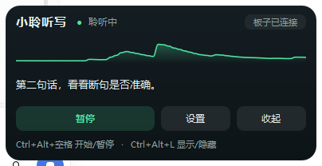
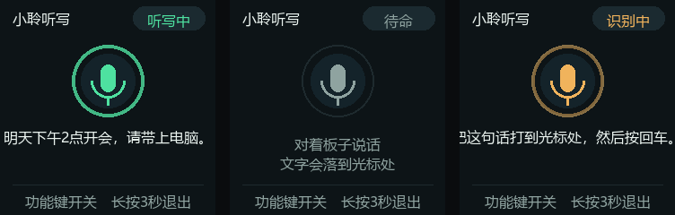

# 小聆听写 · XiaoLing Dictate

> 对着「小聆 AI」开发板说话，文字直接落到电脑光标处。
> 板子当麦克风，识别在本机跑，完全离线；也可以让板子云端识别后通过 WiFi 把文字回传。


## 它是什么

一块 LISTENAI ARCS-Mini3 开发板 + 一个电脑端小软件：

- **USB 模式**（零固件改动）：板子的 USB Audio（UAC）当麦克风，电脑端用 Silero VAD 断句 + SenseVoice 离线识别，再逐字键入到当前光标
- **无线模式**（需要烧一次固件）：板子云端识别完，把文本通过 UDP 广播给电脑，拔线也能用
- **设备端小应用**：板子屏幕上显示听写状态、音量、最近一句；功能键开关听写
- **语音启动**：说「小聆小聆，帮我打开听写」直接拉起板子上的听写界面

## 效果

| 电脑端面板 | 板子屏幕 | 说明 |
| --- | --- | --- |
|  |  | 悬浮面板 + 240×240 设备界面 |

演示视频：[Releases](../../releases) 里的 `demo.mp4`

## 架构

```
                 ┌──────────────── USB 模式（默认） ────────────────┐
板子麦克风 ──UAC──▶ 电脑端：Silero VAD 断句 → SenseVoice 离线识别 ──▶ SendInput 光标上屏
                 └──────────────────────────────────────────────┘

                 ┌──────────────── 无线模式（需刷固件） ─────────────┐
你说话 ─▶ 板子唤醒 ─▶ 云端 ASR ─▶ 板子（SESSION_VOICE_IAT）──UDP 8899──▶ 电脑端上屏
                 └──────────────────────────────────────────────┘
```

## 快速开始

### 电脑端

```powershell
cd voice-input
python -m pip install -r requirements.txt
python tools\download_models.ps1      # 下载 SenseVoice + Silero VAD（约 230 MB）
启动小聆听写.vbs                       # 或 python app.py
```

详细说明见 [voice-input/README.md](voice-input/README.md)。

### 固件（可选，为了无线模式 + 语音启动）

固件基于上游 **mini-v3.1.0**，只加了一条旁路，不改原有语音助手：

| 文件 | 作用 |
| --- | --- |
| `dictate_bridge.c/.h` | 把云端识别文本 UDP 广播给电脑（8899），支持 KV 单播地址 |
| `dictate_app.c/.h` + `dictate_app_lua.h` | 把听写小应用编进固件，语音指令本地拉起/退出 |

应用步骤见 [firmware/README.md](firmware/README.md)。

## 目录结构

```
voice-input/       电脑端 Python 应用（PySide6 + sherpa-onnx + SendInput）
  dictation/       采集、VAD、识别、上屏、HTTP 联动
  device/          Lua 小应用（板子屏幕界面）
  tools/           自测、模型下载、烧录、视频与字幕生成
firmware/          固件改动（新增源文件 + 补丁），不含厂商 SDK
docs/              截图
```

## 这套方案踩过的坑

1. 板子送出的 UAC 电平很低，需要自动增益；否则 VAD 触发不了
2. VAD 切句会吞掉第一个字，需要 400 ms 前滚缓冲
3. `ctypes` 的 `INPUT` 结构体 `dwExtraInfo` 必须是 `c_size_t`，否则 28 字节、SendInput 静默失败
4. Windows PowerShell 5.1 会把 `adb push` 的 stderr 当错误，烧录脚本要 `2>$null`，并且**必须先 `recovery exit` 再重启**，否则分区没写完就断电会变砖
5. 板子上没有截屏接口，固件的显示驱动只写不读，所以设备画面只能靠摄像头拍

## 许可证

本项目代码（`voice-input/`、`firmware/` 下的新增文件与补丁）采用 **MIT**。
`arcs_mini` 固件本体、ARCS SDK、SenseVoice / sherpa-onnx / Silero VAD 模型分别遵循其原有许可证，见 [NOTICE.md](NOTICE.md)。

## 相关链接

- 上游固件：<https://cloud.listenai.com/CSKG836746/arcs-sdk/public/arcs_mini>
- LingClaw Lua SDK：<https://github.com/LISTENAI/LingClaw-SDK>
- sherpa-onnx：<https://github.com/k2-fsa/sherpa-onnx>
- SenseVoice：<https://github.com/FunAudioLLM/SenseVoice>
