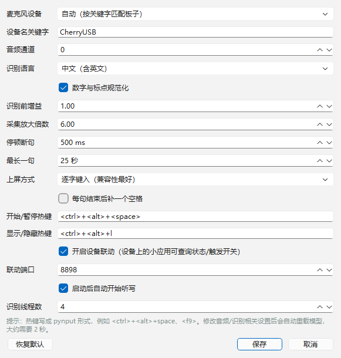

# 小聆听写

把「小聆 AI」开发板当成一支悬浮麦克风：**对着板子说话，文字直接出现在电脑当前光标的位置**。

- 完全离线识别（SenseVoice 中文模型，本地 CPU），不联网、不上传语音。
- 说话自动断句，停顿约 0.5 秒即上屏，不用按键。
- 悬浮小面板显示状态、电平和最近一句；支持托盘、全局热键、暂停。
- 板子屏幕上还能显示一个听写小界面（Lua 小应用），按键即可开始/暂停电脑端听写。


---

## 一、快速开始

1. **插好板子**（USB 连电脑），确认设备管理器里出现 `CherryUSB UAC1 Audio`。
2. 双击 **`启动小聆听写.vbs`**（无控制台启动）或 `启动小聆听写.bat`。
3. **在设备上开启听写模式**（二选一）：
   - 托盘菜单 →「在设备上开启听写（推送小应用）」，板子屏幕会出现听写界面，电脑端自动进入听写模式；
   - 或者直接按 `Ctrl + Alt + 空格` 在电脑端开启。
4. 把光标点进记事本 / 微信 / 浏览器输入框等任意可输入的地方，**直接说话**。

面板显示「听写中」才会收音上屏；默认是「待命」，**不会一直偷听**。

> 关闭听写：再按一次 `Ctrl + Alt + 空格`，或在设备小界面里按一下功能键，或长按 3 秒退出小应用（会自动关闭）。

### 快捷键

| 快捷键 | 作用 |
| --- | --- |
| `Ctrl + Alt + 空格` | 开启 / 关闭听写 |
| `Ctrl + Alt + L` | 显示 / 隐藏面板 |

热键可在设置里改（pynput 语法，例如 `<f9>`、`<ctrl>+<shift>+d`）。

---

## 二、两种工作方式

| | USB 模式（默认，免改固件） | 无线模式（需刷一次固件） |
| --- | --- | --- |
| 板子怎么连 | USB 线插电脑 | 只要有 WiFi，不用插线 |
| 声音去哪 | 板子 USB 音频 → 电脑本地识别 | 板子送到 LingClaw 云识别，文字再广播给电脑 |
| 识别引擎 | 电脑本地 SenseVoice（离线、不花钱） | 云端 ASR（要联网，走设备原有账号） |
| 怎么触发 | 直接说话（VAD 自动断句） | 先说唤醒词「小聆小聆」，再说内容 |
| 板子会不会回话 | 不会（只当麦克风） | 会（顺带当成语音助手回一句） |
| 离线可用 | 可以 | 不行 |

电脑端两种方式可以共存：设置里「输入来源」选 **自动**，插着线用 USB，拔了线自动等无线文本。

### 它是怎么工作的（USB 模式）

```
板子麦克风 ──USB Audio(UAC)──▶ 电脑端「小聆听写」
                                    │
                     Silero VAD 断句（Silero VAD + 前置缓冲）
                                    │
                     SenseVoiceSmall 离线识别（中英日韩粤）
                                    │
                     SendInput 逐字键入 / 剪贴板粘贴 ──▶ 当前光标处
```

### 它是怎么工作的（无线模式）

```
你说话 ──▶ 板子唤醒 ──▶ 音频上云 ──▶ 云端 ASR
                                        │
                          识别文本回到板子（SESSION_VOICE_IAT）
                                        │
                    UDP 广播 8899（JSON：{"app":"xl-dictate","type":"iat","text":"..."}）
                                        │
                     电脑端接收 ──▶ SendInput ──▶ 当前光标处
```

关键点：

- 板子固件会把 4 通道音频（原始麦克风 / 参考 / 降噪后 / 上传云端）通过 USB Audio 送出来，电脑端把它当成普通麦克风即可，**USB 模式不需要改固件**。
- 板子上的 Lua 小程序沙箱**没有麦克风权限**，所以纯靠小程序无法把声音送出来；无线模式必须给固件加一小段「识别文本转发」代码（见第八节）。
- 板子送出的电平偏低，程序里做了自动增益（起音快、释放慢），再交给 VAD。
- 识别完全在本机 CPU 上跑，4 线程时 5 秒语音约 0.2 秒识别完；内存占用约 600 MB，闲置时 CPU 基本为 0。

## 三、无线模式（不插线）

> 已在真机验证：板子（192.168.1.58）云端识别完 → UDP 广播 → 电脑端收到并上屏。

1. 刷一次带 `dictate_bridge` 的固件（见第九节），之后就不用再插线。
2. 让板子连上 WiFi，电脑和板子在同一局域网。
3. 电脑端设置里「输入来源」选 **自动** 或 **只用无线**。
4. 说「小聆小聆，把这句话打到电脑上」——停顿约 1 秒后文字出现在光标处。

细节：

- 电脑端监听 **UDP 8899**（可在设置里改）。首次运行 Windows 会弹防火墙提示；也可以用管理员权限执行一次：
  `netsh advfirewall firewall add rule name="XiaoLing Dictate UDP 8899" dir=in action=allow protocol=UDP localport=8899`
- 路由器如果隔离了广播，可以让板子额外单播给电脑：
  `adb shell kv set user.dictate_ip string 192.168.1.86`（换成电脑 IP，重启生效）。
- 无线模式依赖云端识别，必须联网。云端可能把一句话切成几段返回，所以有时只上屏前半句。
- 识别结果偶尔会带上开头的唤醒词（如「小艺小艺」），程序会按 `config.json` 里的 `strip_prefixes` 自动去掉。
- 想确认链路是否通：`curl http://127.0.0.1:8898/state`，`net_hits` 增加、`net_last_client` 是板子 IP 就说明收到过。


---

## 四、设备端界面（听写模式开关）

板子是 240×240 的屏幕，这个 Lua 小应用就是「听写模式」的开关：

- **打开小应用 = 电脑端进入听写模式**（小应用启动时调用 `/arm`），关掉/退出 = 电脑端退回待命（`/disarm`）。
- 功能键按一下 = 切换开/关；长按 3 秒 = 退出小应用（会自动关闭听写）。

用法：

1. **语音打开（推荐）**：说「小聆小聆，帮我打开听写」——固件里内置了这个听写小应用，识别到就本地启动，不需要电脑推。
2. 电脑托盘菜单 →「在设备上开启听写（推送小应用）」（USB 连着时的备用方式）。
3. 板子跑起界面后自动进入听写；按功能键可开关，长按 3 秒退出。
4. 说「关闭听写 / 结束听写」也会退出小应用。

- 界面（API 5 画法，240×240）：顶部标题 + 状态胶囊（听写中 / 识别中 / 待命 / 未连接），中间圆形麦克风图标（外圈随音量发光），下面是最近一句识别结果（自动换行、居中），底部按键提示。

> 小应用源码（6.4 KB）已经**编进固件**（`dictate_app_lua.h`），所以语音启动不需要电脑参与，板子重启后也能直接语音打开。
> 修改 Lua 后要重新生成头文件并重烧固件：
> `python tools/gen_dictate_app_header.py` → 重新 `build.ps1` → 烧录。
> 无线联动（UDP 回传）要求板子和电脑在同一 WiFi；电脑 IP 变了就改 `device/ling-dictate.lua` 顶部的 `PC_HOST`，重新生成并烧录。
>
> 实测结论：**小应用运行期间，无线回传（云端 ASR 文本）照常工作**。官方文档说小应用活跃时云端会过滤闲聊意图，但 ASR 结果本身仍会下发；只是设备不会像平时那样接话。

电脑端也可以通过 HTTP 查询状态，方便自己写别的联动：

```bash
curl http://127.0.0.1:8898/state     # 当前状态、最近文本、电平
curl http://127.0.0.1:8898/toggle    # 切换开始/暂停
```

---

## 五、设置

点面板上的「设置」，或托盘菜单 →「设置…」。常用项：



| 设置 | 说明 |
| --- | --- |
| 麦克风设备 | 默认「自动」按关键字 `CherryUSB` 找板子；找不到时可手动选 |
| 音频通道 | 0=原始麦克风（默认）；2=降噪后；3=上传云端（带回声消除，若被板子自己的回话干扰可以试） |
| 识别语言 | 中文（含英文）/ English / 日本語 / 한국어 / 粤语 / 自动 |
| 停顿断句 | 说话停多久算一句结束，默认 500 ms；说长句可调大 |
| 上屏方式 | 逐字键入（兼容性最好，推荐）/ 剪贴板粘贴（超长文本更快） |
| 采集放大倍数 | 自动增益的上限，默认 6；安静环境识别不稳可调大 |
| 联动端口 | 设备端界面用的 HTTP 端口，默认 8898 |

改完保存会自动重载模型（约 2 秒）。配置也保存在同目录的 `config.json` 里，可以直接用文本编辑器改。

---

## 六、常见问题

**面板一直显示「出错 / 没有找到可用的麦克风」**
先确认板子插好，设备管理器 → 音频输入和输出 里应能看到 `CherryUSB UAC1 Audio`。如果插拔过，程序会自动重连；也可以重启程序。设置里可以手动指定设备。

**说出了字，但光标处没反应**
先确认目标窗口是**获得焦点**的（面板本身不抢焦点，点面板不会把焦点带走）。某些游戏、远程桌面、以管理员权限运行的程序会拦截模拟按键，这时把「上屏方式」改成剪贴板粘贴试试。

**识别不准**
- 板子离嘴 20~50 cm 效果最好，避开风扇和音箱。
- 把「采集放大倍数」调大一点，或在设置里把「音频通道」改成 2（降噪后）。
- 说话完整一点：VAD 判停是 500 ms，语速很慢时可以调到 700~900 ms。

**说完一句被板子自己的回话打断**
不要喊「小聆小聆」唤醒词；如果确实触发了语音助手，等它说完再继续，或把音频通道改成 3（回声消除通道）。

**热键没反应**
热键可能和别的软件冲突，换一个（例如 `<f9>`）。个别远程桌面/虚拟机里全局热键失效属于系统限制。

**提示端口被占用**
`config.json` 里把 `bridge_port` 改成别的端口，或关掉「设备联动」。

---

## 七、目录结构

```
voice-input/
├─ app.py                   # 界面与主程序
├─ dictation/
│  ├─ audio.py              # 找板子麦克风、采集、自动增益
│  ├─ asr.py                # Silero VAD 断句 + SenseVoice 识别
│  ├─ inject.py             # SendInput 上屏 / 剪贴板粘贴
│  ├─ engine.py             # 采集→断句→识别→上屏 的流水线
│  ├─ bridge.py             # 给设备端界面用的 HTTP 服务
│  └─ config.py             # 配置读写
├─ device/ling-dictate.lua  # 设备端 Lua 小应用
├─ models/                  # 离线模型（SenseVoice int8 + Silero VAD）
├─ tools/                   # 自测脚本（联调、上屏、截图）
├─ config.json              # 首次运行生成
├─ 启动小聆听写.vbs / .bat
├─ 安装设备端界面.bat
└─ 安装开机启动.ps1
```

---

## 八、开发与自测

```powershell
# 依赖：numpy sounddevice soundfile scipy PySide6 pynput pyperclip uiautomation
python -m pip install sherpa-onnx sounddevice soundfile scipy PySide6 pynput pyperclip uiautomation

# 无界面联调：对着板子说话，看识别结果
python tools\pipeline_test.py 15

# 闭环自测：用 TTS 播一句话，看识别结果（会自动播放，适合没有真人说话时验证）
python tools\loop_test.py 12 0

# 上屏自测：验证 SendInput / 剪贴板粘贴
python tools\test_inject_qt.py type
```

模型：

- 识别：[SenseVoiceSmall](https://github.com/FunAudioLLM/SenseVoice)（`sherpa-onnx-sense-voice-zh-en-ja-ko-yue-2024-07-17` 的 int8 版本）
- 断句：[Silero VAD](https://github.com/snakers4/silero-vad)
- 推理框架：[sherpa-onnx](https://github.com/k2-fsa/sherpa-onnx)（Apache-2.0）

模型文件较大（约 230 MB），已放在 `models/` 下，不需要联网下载。

---

## 九、和固件的关系

### USB 模式：不改固件

- 音频来源：固件 `app_usb_cherry_audio.c` 把唤醒流数据（mic / ref / algo / cloud）以 4 通道 16 kHz 16 bit 送到 USB。
- 屏幕界面：通过 `adb push` 到 `/miniapp/`，属于固件自带的 Lua 小应用运行器。
- 状态联动：电脑端开一个小 HTTP 服务（8898），设备端 Lua 定时查询。

### 无线模式：固件改动（一次性烧录）

固件源码基于上游 **mini-v3.1.0**（和板子出厂版本一致），改动很小，只加了一条「识别文本 → UDP 广播」的旁路，不影响原有语音助手：

| 文件 | 改动 |
| --- | --- |
| `src/server/lschat_server/dictate_bridge.c` / `.h` | 新增：UDP 广播识别文本（端口 8899，JSON），支持 KV `user.dictate_ip` 单播 |
| `src/server/lschat_server/dictate_app.c` / `.h` + `dictate_app_lua.h` | 新增：把听写小应用编进固件，识别到「打开/开始 + 听写/小聆」时本地启动，识别到「关闭/结束」时退出 |
| `src/server/lschat_server/voice_cloud.c` | 在 `SESSION_VOICE_IAT` 缓存文本并调用 `dictate_app_handle_text()`，`IAT_END` / 会话结束时调用 `dictate_bridge_send_text()` |
| `src/server/lschat_server/CMakeLists.txt` | 加入新源文件 |

编译与烧录（仓库根目录，**路径不要带中文**，否则 `objcopy` 会失败）：

```powershell
subst X: "D:\dev\小聆AI"          # 映射一个纯英文路径
cd X:\arcs_mini
# 板型是 arcs_mini3，不是 arcs_mini！
.\build.ps1 -S .\apps\arcs-mini -B build-dictate3 -DBOARD=arcs_mini3
.\adb_download.ps1 -S res\arcs-mini3 -B build-dictate3 app
```

烧完板子重启即生效（固件版本会显示成 `3.1.0-<本地提交号>`），之后完全不用插线。
想恢复官方固件，重新烧上游同名 tag 构建出的 `arcs-mini.bin` 即可。

### 烧录踩过的坑（很重要）

1. **板型**：这台设备是 `arcs_mini3`（Recovery 模式下 `adb devices -l` 显示 `product:mido`，正常模式才是 `arcs_mini3`）。用错板型 `adb_download.ps1` 会直接拒绝。
2. **`recovery exit` 不能省**：脚本的收尾顺序是 `push → adb shell recovery exit → adb shell reboot hard`。少了 `recovery exit`，分区数据没提交就断电，设备会直接变砖（本次已踩：开不了机、USB 不枚举）。
3. **PowerShell 5.1 的 stderr 坑**：`adb push` 的进度走 stderr，会被 5.1 当成错误，配合脚本里的 `$ErrorActionPreference = "Stop"` 会让脚本在 push 结束后中断。本仓库的 `adb_download.ps1` 已加 `2>$null` 修掉；`edit` 修改 `.ps1` 后要确保文件仍是 **UTF-8 with BOM**，否则中文引号解析失败。
4. **USB 线**：劣质线会表现为「设备能被 Windows 认出、但 adb 握手超时（error 121）」，`adb devices` 一直 `offline`。换一根数据线即可。

### 救砖步骤（设备卡死 / 开不了机）

1. 进 Recovery：USB 插着 → **按住功能键** → **短按 RST** → 松开功能键（屏幕出现 ADB 更新模式）。
2. 确认在线：`adb devices` 出现 `BOOT-xxxx device`（如果是 `offline`，先换线换口）。
3. 手工烧 app 分区（顺序不能改）：

```powershell
cd X:\arcs_mini
adb push build-dictate3\arcs-mini.bin /RAW/NAND/600000
adb shell recovery exit
adb shell reboot hard
```

4. 等 15 秒，`adb shell version` 能返回就说明活了。

如果以后想让板子在「非唤醒状态」也有稳定的高电平音频（真正的常开无线听写），需要在固件里把麦克风 PCM 直通到 WiFi，那属于更大的改动，可以再单独做。
